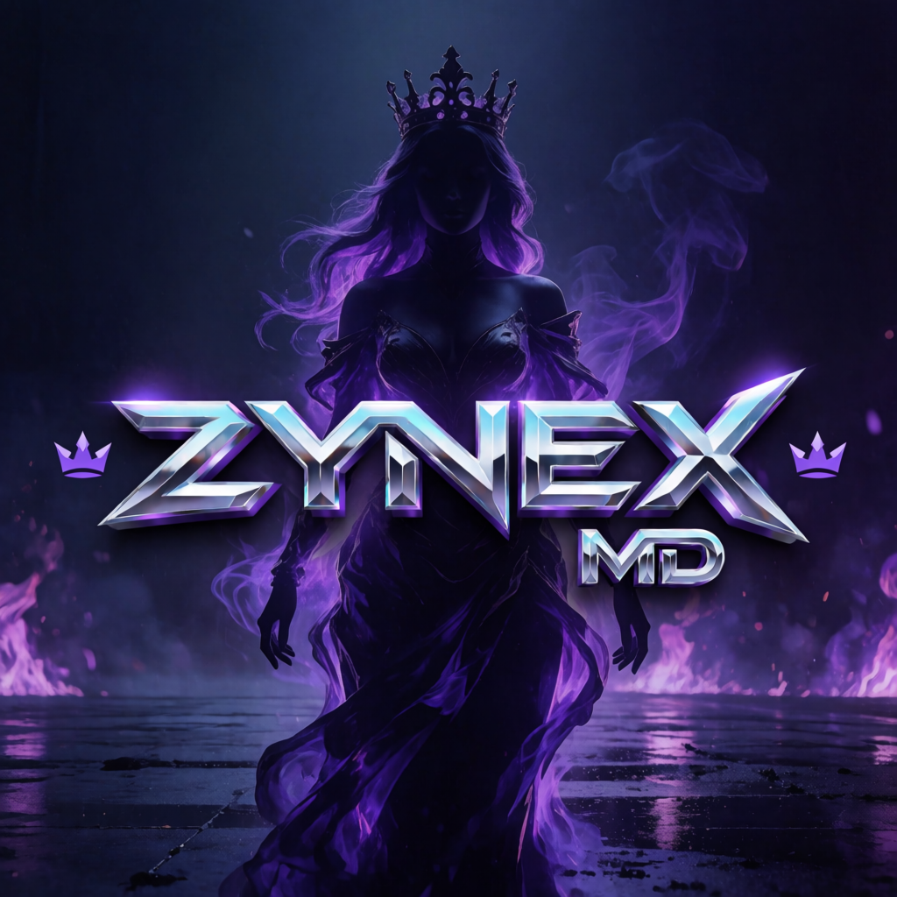

<div align="center">



# ZYNEX-MD

**A WhatsApp bot that tells the truth.**

[](https://github.com/RUTH-BOT-TECH/ZYNEX/stargazers)
[](https://github.com/RUTH-BOT-TECH/ZYNEX/forks)
[](https://github.com/RUTH-BOT-TECH/ZYNEX/issues)

[](https://nodejs.org)
[](https://github.com/WhiskeySockets/Baileys)
[](LICENSE)

[](#commands)
[](#commands)
[](scripts)

<a href="#quick-start"></a>
<a href="ENGINES.md"></a>

</div>

---

## Quick start

```bash
git clone https://github.com/RUTH-BOT-TECH/ZYNEX.git
cd ZYNEX && npm install
cp .env.example .env     # set OWNER_NUMBER
npm start                # open http://localhost:4000 and pair
```

## Commands

`2,139 names · 1,294 working · 60.5%` — the rest answer with an honest refusal and
name a command that does work. Run `.menu` in chat for the live list.

| | |
|---|---|
| **Games** | chess, hangman, tic-tac-toe, 2048, quiz, word games |
| **Stickers** | text stickers, emoji art, circle/crop/blur edits, memes |
| **Media** | logos in 59 styles, converters, image & PDF tools, TTS |
| **Search** | music, anime, TV, news, recipes, Wikipedia, dictionary |
| **Security** | URL scanning, TOTP, hashes, SSL, domain age |
| **Utilities** | WHOIS, DNS, ports, HTTP inspector, zips, PDFs |

## Deploy

Railway, Render or a VPS — it needs a persistent socket.
**Not Vercel, not any serverless platform.**

[](https://railway.app/new/template?template=https://github.com/RUTH-BOT-TECH/ZYNEX)

<div align="center"><sub>Built with Baileys · sharp · ffmpeg-static</sub></div>
