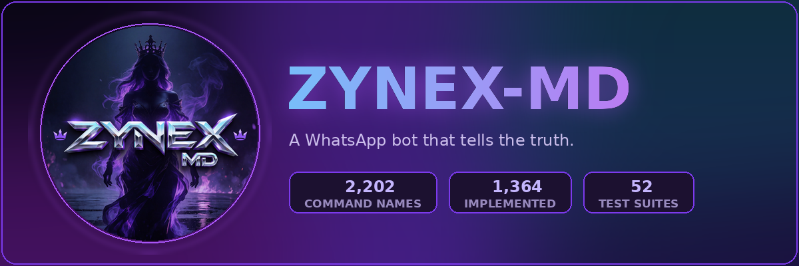
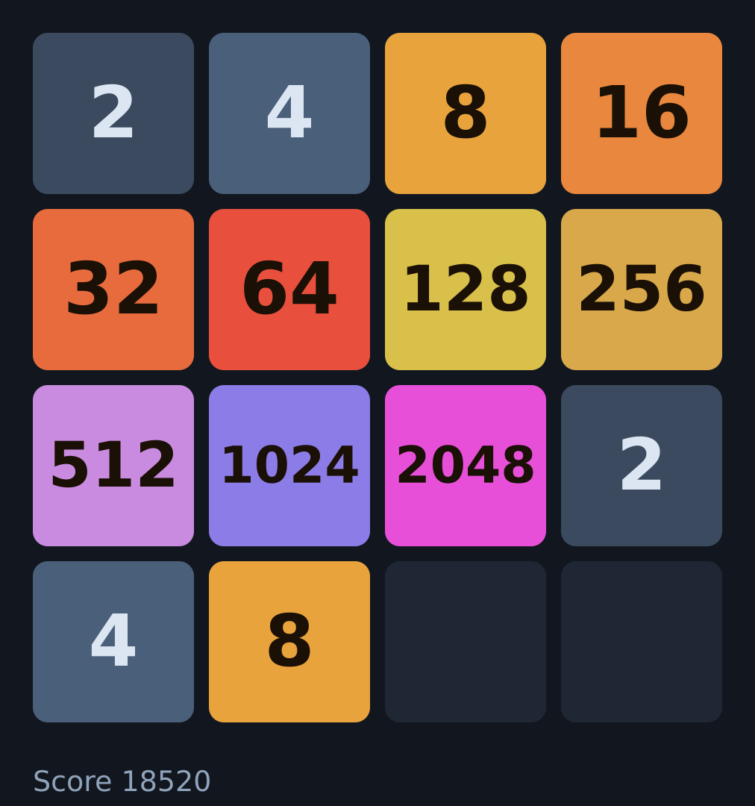
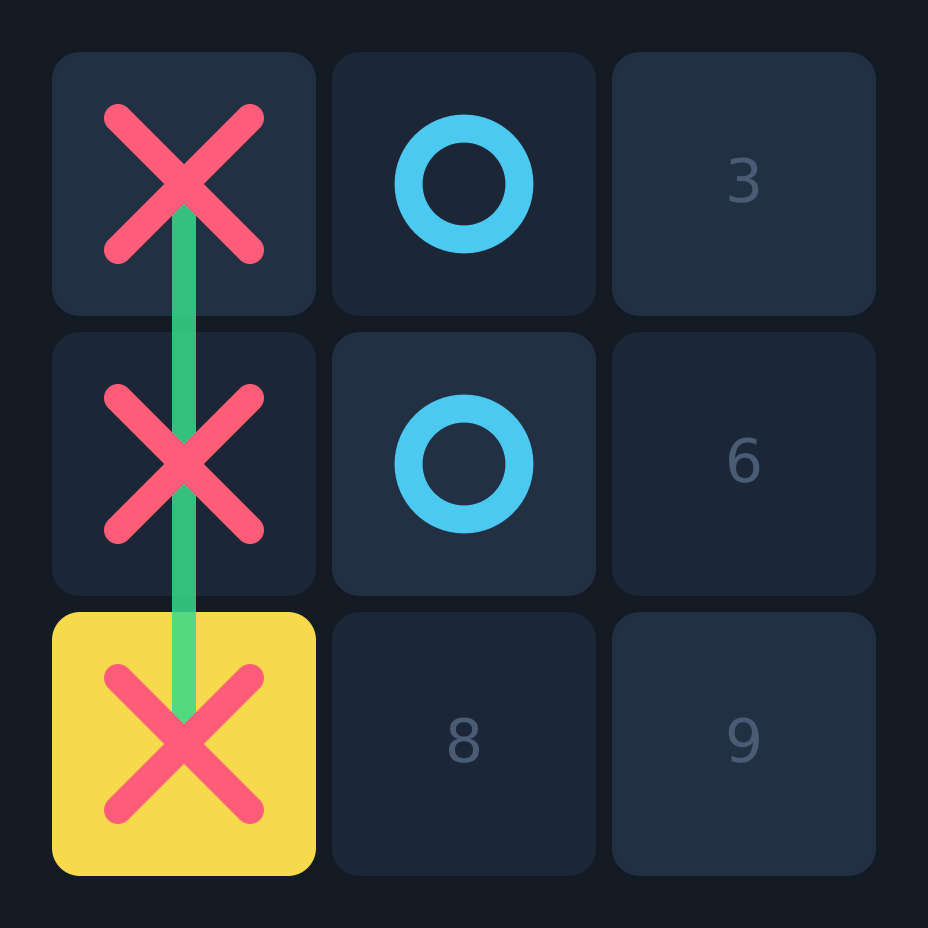

<div align="center">



**A WhatsApp bot that tells the truth.**

[](https://nodejs.org)
[](https://github.com/WhiskeySockets/Baileys)
[](LICENSE)
[](#-by-the-numbers)


</div>

## ⚡ **Quick start**

```bash
git clone https://github.com/RUTH-BOT-TECH/ZYNEX.git && cd ZYNEX
npm install && npm start
```

Open `http://localhost:3001`, pair your number, send `.menu`. Zero config needed.
Rebrand with `BOT_NAME`, `OWNER_NUMBER`, `SITE_URL` → [.env.example](.env.example).

## 🚀 **Deploy**

<p align="center">
  <a href="https://zynex-md-production.up.railway.app"></a>
  <a href="DEPLOY.md"></a>
  <a href="https://railway.app"></a>
  <a href="https://render.com"></a>
</p>

Always-on process + a volume at `/data` with `AUTH_DIR_ROOT=/data`. Railway, Render
(paid), VPS, Fly. **Not serverless** — a WhatsApp socket needs a live process.
`railway.toml` / `render.yaml` are pre-wired → [DEPLOY.md](DEPLOY.md).

## 📊 **By the numbers**

<div align="center">


</div>

**2,202 names · 1,364 implemented (61.9%) · 838 honest refusals.** `.vv` opens
view-once media (yours or anyone's), `.play` returns full tracks, and a command
that can't run says why and names one that works.

## 🖼️ **In chat**

<div align="center"><table><tr>
<td align="center"><br><sub><i>Sticker</i></sub></td>
<td align="center"><br><sub><i>2048</i></sub></td>
<td align="center"><br><sub><i>Tic-tac-toe</i></sub></td>
</tr></table></div>

## 📚 **Docs & verify**

[DEPLOY.md](DEPLOY.md) · [RAILWAY-NOTES.md](RAILWAY-NOTES.md) · [HEALTH.md](HEALTH.md) ·
[VV.md](VV.md) · [PLAY.md](PLAY.md) · [ENGINES.md](ENGINES.md) ·
[STRUCTURE.md](STRUCTURE.md) · [APIS.md](APIS.md) · [SECURITY.md](SECURITY.md) ·
[REPAIR.md](REPAIR.md)

`npm run test:all` → 52 suites, exit 0 · `npm run coverage` → the numbers above.

<div align="center">

<a href="https://github.com/RUTH-BOT-TECH/ZYNEX/issues"></a>
<a href="https://github.com/RUTH-BOT-TECH/ZYNEX"></a>
<br><sub>ZYNEX-MD © 2026 · MIT · Baileys · sharp · ffmpeg-static</sub>

</div>
