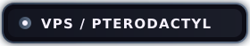
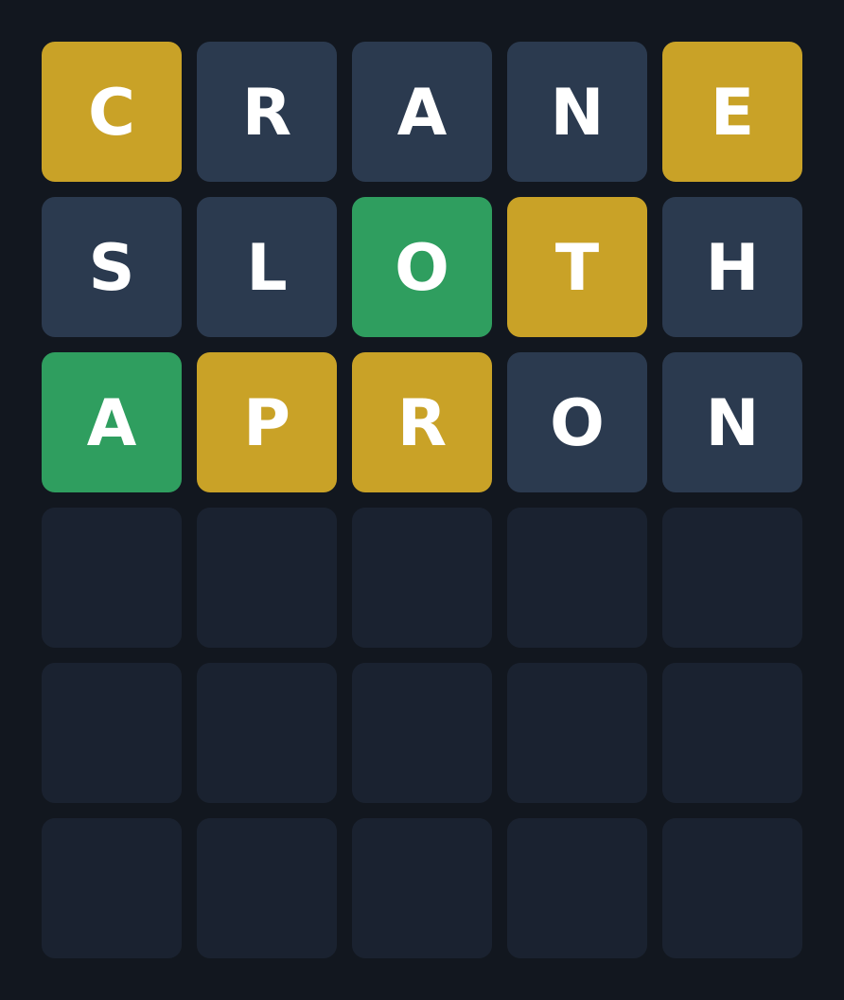
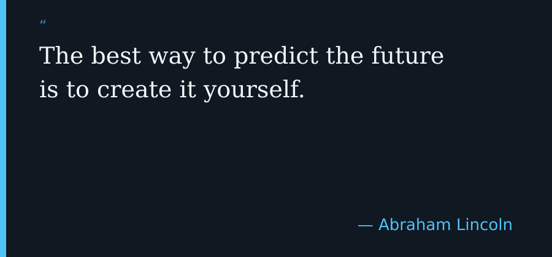
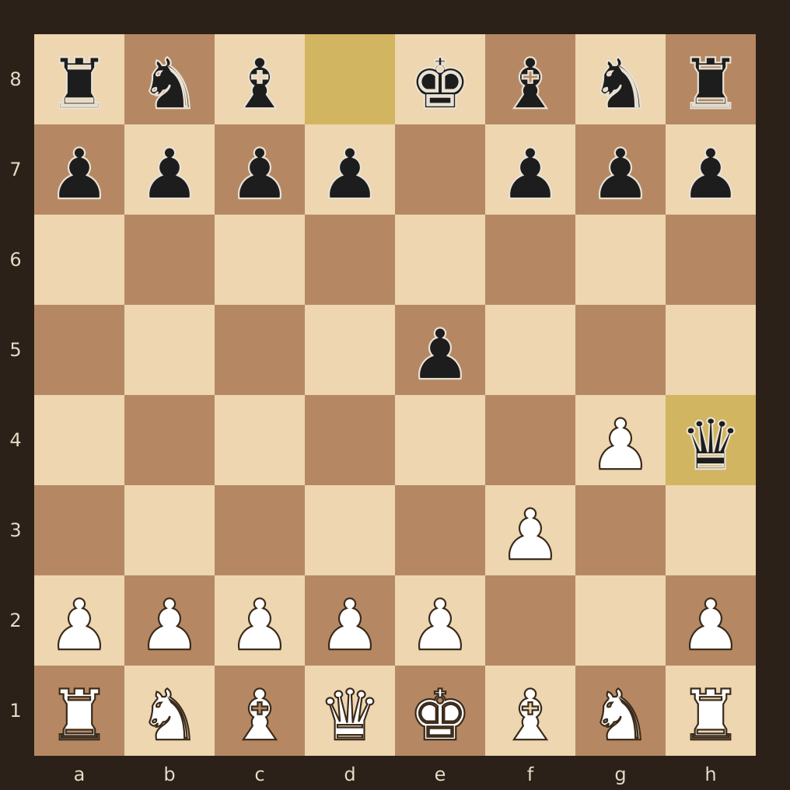

<div align="center">


**A WhatsApp bot that tells the truth.**

<br>

[](https://nodejs.org)
[](https://github.com/WhiskeySockets/Baileys)
[](LICENSE)
[](#-verify-before-you-ship)
[](https://github.com/RUTH-BOT-TECH/ZYNEX)


</div>

---

## 📌 **How to connect ZYNEX-MD**

Four steps, no config file hunting. Pair with your WhatsApp number, pick a host,
and the bot is live.

### **Step 1: Get your session ID**

<p align="center">
  <a href="https://zynex-md-production.up.railway.app" target="_blank">
    
  </a>
  <br>
  <sub>Enter your number on the pairing site → copy the code → WhatsApp <b>Linked devices</b> → <b>Link with phone number</b>.</sub>
</p>

> Self-hosting instead? Deploy first (Step 3), then open **your** `SITE_URL` and
> pair there. Never paste a session ID from somebody else's deployment.

### **Step 2: Configure settings**

Zero configuration is a real option — the bot boots with sane defaults. To make it
yours, copy `.env.example` to `.env` or set the same keys in your host's
dashboard:

| Key | What it does |
|---|---|
| `BOT_NAME` | Name in chat, stickers, logos, packaging and the panel |
| `OWNER_NUMBER` | Digits only — country code, no `+`, no leading `0` |
| `SITE_URL` | The URL your users pair on |
| `DEVICE_IDENTITY` | **Leave empty.** It auto-matches the platform your session was linked as — this is what makes `.vv` work |

Everything else (AI key, yt-dlp cookies/proxy, `AUTH_DIR_ROOT`…) is optional and
documented in [`.env.example`](.env.example) and [DEPLOY.md](DEPLOY.md).

### **Step 3: Choose hosting**

The bot holds a **live WhatsApp socket** and writes state to disk. You need an
always-on process and a volume that survives a restart — not a serverless function.

<p align="center">
  <a href="DEPLOY.md"></a>
  <a href="https://railway.app" target="_blank"></a>
  <br>
  <a href="https://render.com" target="_blank"></a>
  <a href="DEPLOY.md"></a>
</p>

Local run (or any VPS):

```bash
git clone https://github.com/RUTH-BOT-TECH/ZYNEX.git
cd ZYNEX
npm install
npm start
# pairing site → http://localhost:3001   (PORT / SERVER_PORT overrides it)
```

`railway.toml`, `render.yaml` and `.nixpacks.toml` are already wired: start
command `node server.js`, healthcheck `/health`.

### **Step 4: Start using**

Send `.menu` for the live command list, `.vv` to reply to a view-once photo, and
`.play <song>` for audio. That is the whole onboarding.

<br>

<div align="center">
  <a href="VV.md"></a>
  <a href="PLAY.md"></a>
</div>

---

## ✨ **Why ZYNEX-MD**

| | |
|---|---|
| 🟢 **It refuses honestly** | A command that cannot run answers with a clear reason and names one that works. No silent no-ops, no invented success. |
| 🟣 **Android-matched identity** | The session's linked platform is read from `creds.platform` and matched on every boot. Since WhatsApp's Nov 2026 change, view-once media is fanned out only to Android companions — [VV.md](VV.md) explains the fix. |
| 👁 **Late media is caught** | `.vv` waits up to 90 seconds for a delayed view-once payload, serves it from cache, and works on **your own** and other people's messages. |
| 🎵 **Full-length audio** | `.play` falls back to SoundCloud full tracks instead of truncating YouTube previews to 30 seconds. See [PLAY.md](PLAY.md). |
| 💾 **One variable moves all state** | `AUTH_DIR_ROOT` relocates sessions, economy, game boards, group settings, reminders and the media cache together. |
| 🔁 **Rebrand without editing source** | Three env vars rename every user-visible string; `scripts/rebrand-test.cjs` fails the build if the old name leaks back in. |

---

## 🖼️ **What it looks like**

Real output rendered by the test suite — not mock-ups.

<div align="center">
  <table>
    <tr>
      <td align="center"><br><sub><i>Text sticker</i></sub></td>
      <td align="center"><br><sub><i>2048</i></sub></td>
      <td align="center"><br><sub><i>Tic-tac-toe</i></sub></td>
    </tr>
    <tr>
      <td align="center"><br><sub><i>Wordle</i></sub></td>
      <td align="center"><br><sub><i>Quote card</i></sub></td>
      <td align="center"><br><sub><i>Chess</i></sub></td>
    </tr>
  </table>
</div>

---

## 📊 **By the numbers**

<div align="center">


</div>

**2,202 names · 1,364 implemented (61.9%) · 838 honest refusals** — that number
comes from `npm run coverage`, not from a marketing page. Run `.menu` in chat for
the live list.

| | |
|---|---|
| **🎮 Games** | chess, hangman, tic-tac-toe, 2048, sudoku, mines, quiz, word games |
| **🎨 Stickers** | text stickers, emoji art, circle/crop/blur edits, memes |
| **🎬 Media** | logos in 59 styles, converters, image & PDF tools, TTS, view-once |
| **🔎 Search** | music, anime, TV, news, recipes, Wikipedia, dictionary |
| **🛡 Security** | URL scanning, TOTP, hashes, SSL, domain age |
| **🧰 Utilities** | WHOIS, DNS, ports, HTTP inspector, zips, PDFs |

---

## ⚙️ **Make it yours**

Fork it and rename it without opening a single source file:

```bash
BOT_NAME=AZURE-MD                              # name in chat, stickers, panel
OWNER_NUMBER=2348012345678                     # digits only, no + / no leading 0
SITE_URL=https://your-app.up.railway.app       # where your users pair
```

`scripts/rebrand-test.cjs` boots the server as a different bot and fails if any
user-visible string still carries the old name, if the panel stops answering, or
if the name is defined in two places and can drift.

`npm run deploy` pushes to GitHub and runs `railway up` together — it needs an
`origin` remote and a logged-in Railway CLI. Otherwise `git push` your own remote
and let your host auto-deploy.

---

## 🚀 **Hosting: what actually works**

An always-on process **and** a disk that survives a restart. Both, or you will be
re-pairing with a QR code every morning.

| Host | Works? | What to set |
|---|---|---|
| **Railway** | ✅ | Mount a volume at `/data`, set `AUTH_DIR_ROOT=/data` |
| **Render** | ⚠️ paid only | Starter plan (free sleeps + no disk), disk at `/data`, same env |
| **VPS / Pterodactyl** | ✅ | `AUTH_DIR_ROOT=/path/to/state`, or leave unset |
| **Fly.io** | ✅ | A volume, same env |
| **Vercel / Netlify / any serverless** | ❌ | A WhatsApp socket cannot live in a request handler |

`vercel.json` only maps routes to `server.js`; it does **not** make the bot work on
Vercel. Leave `AUTH_DIR_ROOT` unset and everything writes to `./auth_state`, which
is where this project has always written. Forking an existing deployment? Your old
`data/*.json` files are copied into the new location once on first start, so
balances and reminders survive.

Full walkthrough: [DEPLOY.md](DEPLOY.md) · health checks: [HEALTH.md](HEALTH.md) ·
Railway specifics: [RAILWAY-NOTES.md](RAILWAY-NOTES.md).

---

## 📚 **Documentation**

| Deploy & operate | Under the hood |
|---|---|
| [DEPLOY.md](DEPLOY.md) — Railway, volume, env | [STRUCTURE.md](STRUCTURE.md) — file map |
| [RAILWAY-NOTES.md](RAILWAY-NOTES.md) — platform quirks | [ENGINES.md](ENGINES.md) — command engines |
| [HEALTH.md](HEALTH.md) — `/health` and `/api/status` | [APIS.md](APIS.md) — upstream APIs |
| [SECURITY.md](SECURITY.md) — secrets & auth | [REPAIR.md](REPAIR.md) — repair log |
| [PLAY.md](PLAY.md) — audio, yt-dlp, bot-gate | [VV.md](VV.md) — view-once, identity |

---

## 🧪 **Verify before you ship**

<p align="center">
  <a href="#-verify-before-you-ship"></a>
</p>

```bash
npm run test:all     # 52 suites — identity, .vv, .play, media, rebrand, portability…
npm run coverage     # 2,202 names / 1,364 implemented / 838 refusals
```

If a fresh checkout reports a missing `ffmpeg` or `yt-dlp` binary, restore the two
platform-specific tools first (they are never committed):

```bash
npm rebuild ffmpeg-static
node scripts/fetch-ytdlp.cjs
```

---

## 🟢 **Status**

<div align="center">


[](https://zynex-md-production.up.railway.app)
[](https://github.com/RUTH-BOT-TECH/ZYNEX/stargazers)
[](https://github.com/RUTH-BOT-TECH/ZYNEX/commits/main)

<br>

<a href="https://github.com/RUTH-BOT-TECH/ZYNEX/issues"></a>
<a href="https://github.com/RUTH-BOT-TECH/ZYNEX"></a>

</div>

---

<div align="center">


**ZYNEX-MD © 2026 · MIT · Built with Baileys · sharp · ffmpeg-static**

<sub>Every number on this page is generated from the code. If it disagrees with the repo, the repo wins.</sub>

</div>
